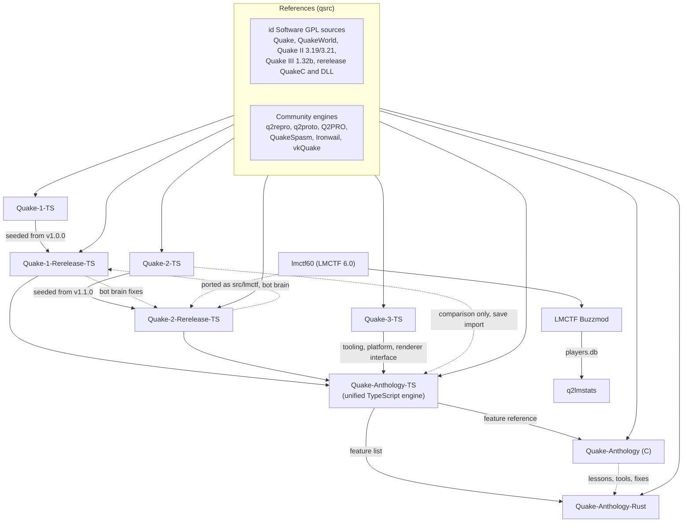

# Quake Project Info

Quake, Quake II and Quake III Arena, rebuilt several times over: ports of each game and its rerelease to TypeScript, a single engine that plays all of them and lets their parts be mixed in one session, and native rewrites of that engine in C and Rust. Alongside the engines is LMCTF Buzzmod, a Quake II capture-the-flag mod built on top of another mod, with a small stats site of its own.

The projects fall into three groups:

1. **Engine ports (August to October 2026).** id Software released the source code of Quake, QuakeWorld, Quake II and Quake III Arena under the GPL, and each game was ported to strict TypeScript on [Bun](https://bun.sh). Separate ports followed for the 2021 Quake and 2023 Quake II rereleases. Those per-game ports were then merged into one TypeScript engine, **Quake-Anthology-TS**, which plays all of the games from one executable. It also lets a single session mix parts from different games: rules, maps, movement, character, weapons and monsters can each come from a different one. Two native rewrites of that engine followed, one in **C** and one in **Rust**.
2. **LMCTF Buzzmod (2020, then 2026).** This is a fork of LMCTF, a 1999 Quake II Capture the Flag mod, so a mod of a mod. It adds rune and flag tossing, persistent player statistics in SQLite and native bots (SLIPGATE). A small web site and API, **q2lmstats**, reads those statistics.
3. **References.** These are clones of id's source releases, community engines (q2repro, QuakeSpasm, Ironwail, vkQuake and others). The ports are checked against them.

## Projects

| Project | Language | Status | What it is | Doc |
|---|---|---|---|---|
| [Quake-1-TS](https://github.com/mgd34msu/Quake-1-TS) | TypeScript (Bun) | Playable (Linux), v1.0.0 | A file-by-file port of WinQuake 1.09 and QuakeWorld 2.33 with software and OpenGL renderers. It builds three binaries: `q1ts`, `qwsv` and `qwcl`. | [quake-1-ts.md](docs/quake-1-ts.md) |
| [Quake-1-Rerelease-TS](https://github.com/mgd34msu/Quake-1-Rerelease-TS) | TypeScript (Bun) | Playable, work in progress, v1.0.1 | An engine for the 2021 Quake rerelease. It speaks NetQuake 15/666/999 and QuakeWorld 28/29, and adds bots, splitscreen, MD5 models and KEX saves. | [quake-1-ts.md](docs/quake-1-ts.md#quake-1-rerelease-ts) |
| [Quake-2-TS](https://github.com/mgd34msu/Quake-2-TS) | TypeScript (Bun) | Playable, finished at v1.2.1 | A port of the id v3.21 source: engine, baseq2, ThreeWave CTF, Xatrix, Rogue, and software and GL renderers. | [quake-2-ts.md](docs/quake-2-ts.md) |
| [Quake-2-Rerelease-TS](https://github.com/mgd34msu/Quake-2-Rerelease-TS) | TypeScript (Bun) | Playable, v1.1.1 plus unreleased work | One engine with two game bindings. One runs the ported 2023 rerelease game module, the other runs the classic modules, LMCTF included. Any content plays under any ruleset. | [quake-2-ts.md](docs/quake-2-ts.md) |
| [Quake-3-TS](https://github.com/mgd34msu/Quake-3-TS) | TypeScript (Bun) | Playable, with documented gaps | Quake III Arena and Team Arena from the 1.32b source, with a CPU and a GL renderer, botlib and protocol 68. | [quake-3-ts.md](docs/quake-3-ts.md) |
| [Quake-Anthology-TS](https://github.com/mgd34msu/Quake-Anthology-TS) | TypeScript (Bun) | Released v1.0.0, playable; 22 of 23 targets accepted | One engine for every game above, plus mixed-game sessions. Original mod code runs unchanged: QuakeC, QVM, and Q2 DLLs through an x86 interpreter. | [quake-anthology-ts.md](docs/quake-anthology-ts.md) |
| [Quake-Anthology](https://github.com/mgd34msu/Quake-Anthology) | C17 (CMake, SDL2) | Works, with open defects; its README says "not ready to play yet" | A native C rewrite of Quake-Anthology-TS that compiles all built-in gameplay to C. | [quake-anthology-c.md](docs/quake-anthology-c.md) |
| [Quake-Anthology-Rust](https://github.com/mgd34msu/Quake-Anthology-Rust) | Rust (edition 2024) | Restarted 2026-10-07; milestone R0, no gameplay | A native Rust engine on shared primitives. | [quake-anthology-rust.md](docs/quake-anthology-rust.md) |
| [lmctf60-buzzmod](https://github.com/mgd34msu/lmctf60-buzzmod) (LMCTF Buzzmod) | C (Quake II game module) | Playable, released v1.0.0 | A fork of LMCTF 6.0 that adds `toss rune` and `toss flag`, SQLite stats, match history and SLIPGATE bots. | [lmctf.md](docs/lmctf.md) |
| [q2lmstats](https://github.com/mgd34msu/q2lmstats) | JavaScript (Node, Express) | Working, small | A read-only stats web site and JSON API over Buzzmod's `players.db`. | [lmctf.md](docs/lmctf.md#q2lmstats) |
| [lmctf60](https://github.com/mgd34msu/lmctf60) | C | Reference | Mike's copy of QwazyWabbit's modernised LMCTF source, which Buzzmod started from. | [lmctf.md](docs/lmctf.md) |
| [yquake2](https://github.com/mgd34msu/yquake2) (fork) | C | Reference, no commits of its own | A fork of the Yamagi Quake II client. | [references-and-tooling.md](docs/references-and-tooling.md#yquake2-fork) |
| Quake-2-TS-baseq2 | n/a | Private | Holds game data for the Quake II ports. It is mentioned here by name only. | [quake-2-ts.md](docs/quake-2-ts.md) |

Reference sources (id's releases, q2repro, q2proto, quake2-rerelease-dll and the community Quake 1 engines) and the shared test area are covered in [references-and-tooling.md](docs/references-and-tooling.md).

## By the numbers

Commit counts and dates come from `git log` in each repository, as recorded in the linked docs. Line counts are `wc -l` over the files named and are not comparable across languages.

| Project | First commit | Last commit | Commits | Size |
|---|---|---|---:|---|
| Quake-2-TS | 2026-08-29 | 2026-09-01 | 109 | 265,954 lines of `.ts` (src, test, scripts) |
| Quake-2-Rerelease-TS | 2026-08-29 | 2026-09-08 | 276 | 780,109 lines of `.ts` (src, test, scripts) |
| Quake-1-TS | 2026-09-04 | 2026-09-06 | 40 | `src` 95,383 lines, `test` 62,119 lines |
| Quake-1-Rerelease-TS | 2026-09-06 | 2026-09-08 | 140 | `src` 132,961 lines, `test` 123,145 lines |
| Quake-3-TS | 2026-09-09 | 2026-09-10 | 7 (history imported in one commit) | `src` 144,415 lines, `tests` 166,540 lines |
| Quake-Anthology-TS | 2026-09-10 | 2026-09-26 | 805 | `src` 365,926 lines, `tests` 92,166 lines |
| Quake-Anthology (C) | 2026-09-26 | 2026-10-07 | 2,119 | 798,355 lines of `.c` and 90,571 lines of `.h` |
| Quake-Anthology-Rust | 2026-09-29 | 2026-10-07 | 1,007 | 717 lines of Rust after the restart (the retired tree had 1,656,411) |
| LMCTF Buzzmod | 2020-03-09 (shared upstream) | 2026-09-03 | about 2,100 on `main` (1,987 by Mike) | about 86,600 lines of `.c` and 13,600 lines of `.h`, plus vendored SQLite |
| q2lmstats | 2020 | 2026-07-28 | 8 | about 1,670 lines of JavaScript |

The eight port repositories add up to 4,503 commits, all made in under six weeks (2026-08-29 to 2026-10-07).

## How the projects relate

In words:

- **Per-game ports.** Quake-2-TS came first (2026-08-29). Quake-2-Rerelease-TS started from a copy of its v1.1.0 the same day. Quake-1-TS followed, then Quake-1-Rerelease-TS, which started from a copy of Quake-1-TS v1.0.0 and took libraries (zip, image formats, fonts, MD5) from the Quake II rerelease port. The two rerelease ports share one bot design and passed fixes back and forth. Quake-3-TS arrived as a finished port in a single import commit.
- **Unification.** Quake-Anthology-TS took code from Quake-1-Rerelease-TS, Quake-2-Rerelease-TS and Quake-3-TS. Quake-3-TS supplied the base: strict tooling, the platform layer and the renderer interface. Quake-2-TS was kept for comparison only, and its save format can still be imported. Quake-1-TS was not used. Where a port's behaviour differed from id's original source, that was treated as a bug to fix ([details](docs/quake-anthology-ts.md#relationship-to-other-projects)).
- **Native rewrites.** The C port started the day Quake-Anthology-TS 1.0.0 was released. It reimplements the TypeScript feature set, and id's sources decide behaviour when the two disagree. The Rust port started three days later. On 2026-10-07 it was restarted: behaviour comes from id's sources, the feature list from the TypeScript engine, and proven fixes and tools from the C port.
- **LMCTF.** Buzzmod is its own C codebase, built as a Quake II game module and tested on Yamagi Quake II. It shares no code with the ports. Separately, the LMCTF mod itself (from `lmctf60`) was ported to TypeScript as a game module inside Quake-2-Rerelease-TS. Quake-Anthology-TS also offers an LMCTF-style grappling hook and LMCTF match state.

## Documents

- [docs/timeline.md](docs/timeline.md): every project in date order.
- [docs/quake-1-ts.md](docs/quake-1-ts.md): Quake-1-TS and Quake-1-Rerelease-TS.
- [docs/quake-2-ts.md](docs/quake-2-ts.md): Quake-2-TS and Quake-2-Rerelease-TS.
- [docs/quake-3-ts.md](docs/quake-3-ts.md): Quake-3-TS.
- [docs/quake-anthology-ts.md](docs/quake-anthology-ts.md): the unified TypeScript engine.
- [docs/quake-anthology-c.md](docs/quake-anthology-c.md): the C port.
- [docs/quake-anthology-rust.md](docs/quake-anthology-rust.md): the Rust port.
- [docs/lmctf.md](docs/lmctf.md): LMCTF, LMCTF Buzzmod, q2lmstats and the Loki's Missions archive.
- [docs/references-and-tooling.md](docs/references-and-tooling.md): reference sources and the shared test area.

## Credits and licences

- **id Software**: Quake (1996), QuakeWorld, Quake II (1997) and Quake III Arena (1999), and their GPL source releases (1999, 2001, 2005). **id Software and ZeniMax / Nightdive Studios**: the 2021 Quake rerelease QuakeC and the 2023 Quake II rerelease game source. All the ports derive from this code.
- **Community engines used as references**: Q2PRO (skuller), q2repro (Paril), q2proto (res2k), QuakeSpasm, Ironwail and vkQuake. Some author credits in the references doc come from public attribution and still need checking; that doc says which.
- **LMCTF**: Loki's Minions (LM_CTF 5.2, 1999), QwazyWabbit (the modern C11 port), Paril and the other upstream contributors.
- **Licences**: the TypeScript ports, the C port and the Rust port are GPL v2 or GPL-2.0-or-later (see each doc). lmctf60 and Buzzmod have no LICENSE file, and q2lmstats's `package.json` says ISC.
- Quake, Quake II and Quake III Arena are trademarks of id Software. None of these projects is affiliated with id Software, ZeniMax or Bethesda.
